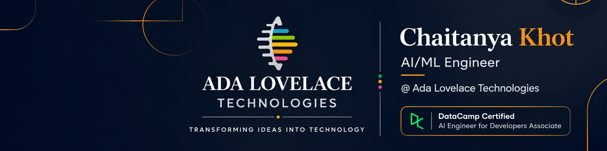
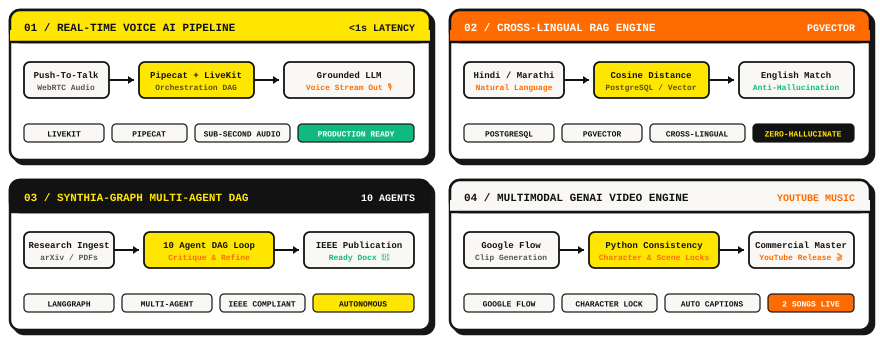

<!-- Hero Banner -->

  

<!-- Quick Action Badges -->

  

<!-- Visual Quick Tagline -->

  <b>AI/ML Engineer</b> @ Ada Lovelace Tech &nbsp;•&nbsp; 
  <b>1+ Year</b> Production Systems &nbsp;•&nbsp; 
  <b>MCA</b> (8.79 CGPA) &nbsp;•&nbsp; 
  <b>PGDBDA</b> (8.80) &nbsp;•&nbsp; 
  <b>Navi Mumbai / Pune</b>

 

### ⚡ Production AI Architectures & Workflows

  

 

### 🛠️ Tech Stack & Systems

  
   
  
   
  

 

### 🚀 Featured Repositories

  
  

  
  

 

### 📈 GitHub Telemetry

  
  

 

### 🎨 Beyond the Terminal

- 📚 **Book Writeups & Reflections:** Sharing breakdowns and thought-pieces on consumed books & ideas on Instagram.
- 🎨 **Sketching:** Traditional and digital sketches & visual design.
- 🎬 **GenAI Video Direction:** Directed commercial YouTube music releases ([*Brahmandacha Dev*](https://youtu.be/EPZ26mBo-eM) & [*Aai Ambe Jagdambe*](https://youtu.be/pzpd0XVPtfo)).

 

### Let's Build Something Impactful.

&nbsp;

&nbsp;

