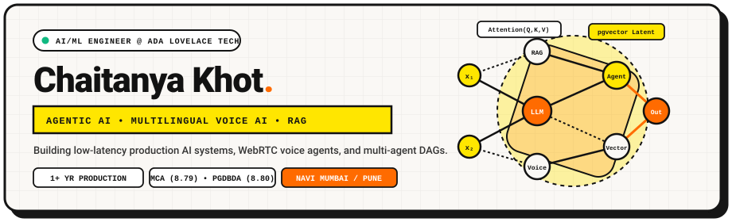

<p align="center">
  
</p>

<p align="center">
  <a href="https://chaitanya-khot-portfolio.netlify.app">
    
  </a>
  <a href="https://linkedin.com/in/mr-chaitanya-khot">
    
  </a>
  <a href="mailto:mr.chaitanya.khot@gmail.com">
    
  </a>
  <a href="https://github.com/KhotChaitanya/my-portfolio">
    
  </a>
</p>

<br/>

```
  01 / WHO I AM
```

### Production AI/ML Systems Engineer • Navi Mumbai / Pune

I am an **AI/ML Engineer with 1+ year of full-time experience** across enterprise internships and a trainee engineering role at Ada Lovelace Technologies. I specialize in turning complex enterprise requirements into high-throughput, latency-optimized, and resilient AI systems.

- 🎙️ **Real-Time Voice AI:** Architected low-latency push-to-talk WebRTC audio counseling agents with **Pipecat** and **LiveKit** orchestration.
- 🔍 **Cross-Lingual RAG:** Built semantic search pipelines using **PostgreSQL (pgvector)** allowing Hindi & Marathi queries to match English records with strict anti-hallucination grounding.
- 🤖 **Autonomous Multi-Agent DAGs:** Engineered multi-agent synthesis workflows coordinating specialized LLM agents for deep research and structured publication output.
- 🎬 **Creative Multimodal GenAI:** Director and engineer of commercial AI music videos on YouTube (*Brahmandacha Dev* & *Aai Ambe Jagdambe*) using Google Flow and custom Python visual consistency pipelines.
- 🎨 **Beyond the Terminal:** Passionate reader and digital creator — sharing thoughtful writeups, book reflections, and reels on Instagram, paired with traditional and digital sketching.

<br/>

```
  02 / PRODUCTION ARCHITECTURES & DELIVERABLES
```

| Project / System | Architecture & Engineering Highlights | Core Stack |
| :--- | :--- | :--- |
| **[Synthia-Graph](https://github.com/KhotChaitanya/Synthia-Graph)** | Autonomous multi-agent research synthesis engine coordinating **10 specialized agents** in a directed acyclic graph (DAG) to generate IEEE-compliant publications. | `LangGraph` `Python` `FastAPI` `VectorDB` |
| **Real-Time Voice AI** | Production push-to-talk WebRTC audio agent with custom speech-to-text, LLM reasoning, and natural voice synthesis at sub-second response latency. | `Pipecat` `LiveKit` `WebRTC` `FastAPI` |
| **Cross-Lingual RAG Engine** | Semantic retrieval pipeline querying vector embeddings across vernacular prompts (Hindi/Marathi) matched against English knowledge bases. | `PostgreSQL` `pgvector` `Python` `LangChain` |
| **24/7 WhatsApp AI Ticketing** | Enterprise customer support bot querying standard operating procedures (SOPs) with strict source citation, auto-escalation, and 60+ days telemetry. | `WhatsApp API` `FastAPI` `Docker` `Redis` |
| **[VectorML Core](https://github.com/KhotChaitanya/vectorml-core)** | High-performance vectorized numerical ML algorithms and optimization routines engineered from first mathematical principles without high-level framework dependencies. | `Pure NumPy` `Linear Algebra` `PyTest` |
| **Multimodal GenAI Videos** | Commercial devotional music videos on YouTube (*[Brahmandacha Dev](https://youtu.be/EPZ26mBo-eM)* & *[Aai Ambe Jagdambe](https://youtu.be/pzpd0XVPtfo)*) with custom Python character & scene stability algorithms. | `Google Flow` `Python` `Video Mastering` |

<br/>

```
  03 / TECH MATRIX
```

#### 🧠 AI, Machine Learning & Agentic Systems


#### 🗄️ Vector Databases & Backend Infrastructure


#### 🌐 Full-Stack Integration


<br/>

```
  04 / GITHUB TELEMETRY
```

<p align="center">
  
  
</p>

<p align="center">
  
</p>

<br/>

```
  05 / LET'S BUILD SOMETHING IMPACTFUL
```

<p align="center">
  <b>Open to full-time AI/ML engineering roles, selected freelance builds, and technical collaborations.</b><br/>
  <i>Usually replies within 24 hours.</i>
</p>

<p align="center">
  <a href="https://chaitanya-khot-portfolio.netlify.app">
    
  </a>
  &nbsp;
  <a href="https://linkedin.com/in/mr-chaitanya-khot">
    
  </a>
  &nbsp;
  <a href="mailto:mr.chaitanya.khot@gmail.com">
    
  </a>
</p>
