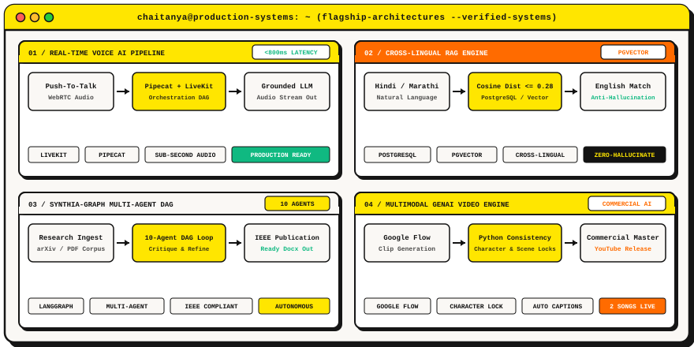
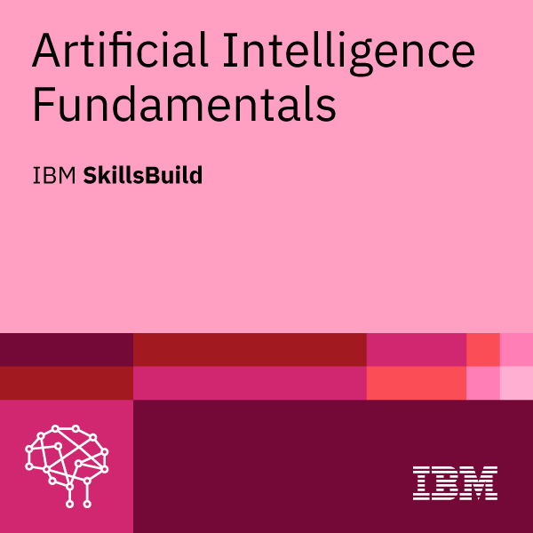
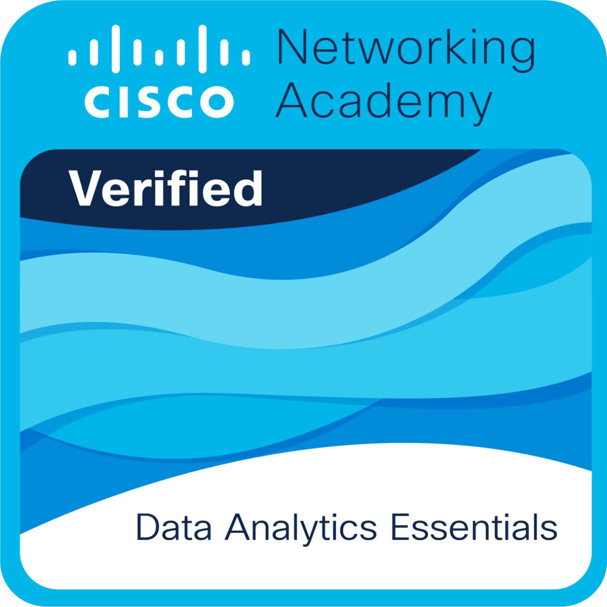
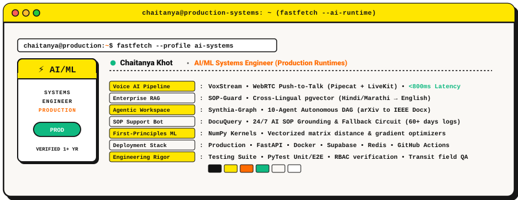
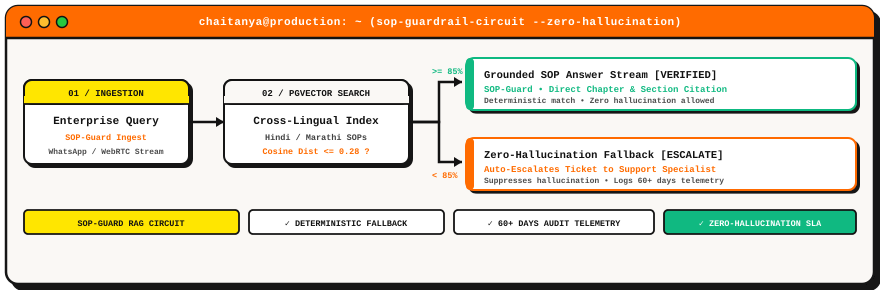
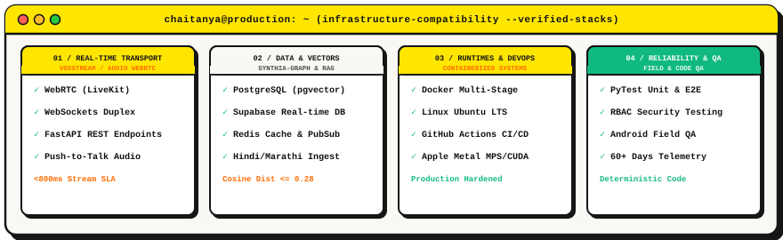

  

<!-- Center-Aligned Connect & Identity Block -->

  

    &nbsp;&nbsp;&nbsp;&nbsp;
  

  

    <b>AI/ML Systems Engineer</b> &nbsp;•&nbsp; 
    <b>1+ Year</b> Production Systems Experience &nbsp;•&nbsp; 
    <b>Navi Mumbai / Pune</b>
  

---

### ⚡ Production AI Architectures & Workflows

  

---

### 📜 Verified Credentials & Badges

  <table border="0">
    <tr>
      <td align="center" width="25%" valign="top">
        
          
        <b>AI Engineer for Developers</b>
         
        DataCamp • Associate
      </td>
      <td align="center" width="25%" valign="top">
        
          
        <b>McKinsey Forward</b>
         
        McKinsey &amp; Company
      </td>
      <td align="center" width="25%" valign="top">
        
          
        <b>AI Fundamentals</b>
         
        IBM • Neural Nets &amp; ML
      </td>
      <td align="center" width="25%" valign="top">
        
          
        <b>Data Analytics Essentials</b>
         
        Cisco • Statistical Analysis
      </td>
    </tr>
  </table>

---

### 💻 Production AI Systems & Architecture Specs

  

---

### 🛠️ Languages & Tools

| 👨‍💻 Core & Languages | 🧠 AI, ML & Frameworks | 🗄️ Databases & Vector Stores | 🧰 DevOps & Full-Stack |
|:---:|:---:|:---:|:---:|
| &nbsp;&nbsp;&nbsp;&nbsp;&nbsp;&nbsp; | &nbsp;&nbsp;&nbsp;&nbsp;&nbsp;&nbsp; | &nbsp;&nbsp;&nbsp;&nbsp;&nbsp;&nbsp;&nbsp;&nbsp; | &nbsp;&nbsp;&nbsp;&nbsp;&nbsp;&nbsp;&nbsp;&nbsp; |

---

### 🛡️ Enterprise Guardrails & Deterministic Fallback Circuit

  

---

### Contribution Activity

<picture>
  <source media="(prefers-color-scheme: dark)" srcset="https://raw.githubusercontent.com/KhotChaitanya/KhotChaitanya/output/github-contribution-grid-snake-dark.svg" />
  <source media="(prefers-color-scheme: light)" srcset="https://raw.githubusercontent.com/KhotChaitanya/KhotChaitanya/output/github-contribution-grid-snake.svg" />
  
</picture>

---

### 🌐 Enterprise Infrastructure & Protocol Compatibility

  

